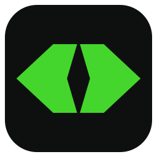

# OpenRazerProfiler

**Configuração de teclados Razer gravada diretamente na memória do aparelho.**

[Download da versão mais recente](https://github.com/xp3z41x/OpenRazerProfiler/releases/latest) · [Guia de uso](docs/USO.md) · [Licença MIT](LICENSE)

---

## Apresentação

O OpenRazerProfiler é um aplicativo para Windows que grava as configurações do teclado **diretamente na memória do próprio aparelho**: perfis, iluminação, remapeamento de teclas e taxa de polling. Após a gravação, o aplicativo pode ser encerrado, e o teclado mantém as configurações em qualquer computador, sem a necessidade de software adicional.

O aplicativo é um **substituto parcial do Razer Synapse**. Ele abrange as configurações que o próprio teclado é capaz de armazenar, dispensando o Synapse no uso cotidiano. Os recursos que dependem de um software em execução contínua no computador, como efeitos de iluminação gerados pelo Razer Chroma e integrações com jogos e outros aplicativos, ficam deliberadamente de fora, em respeito ao princípio de não manter nenhum processo em segundo plano.

## Princípios

- **Simplicidade.** Uma única janela: abrir, ajustar, gravar e encerrar.
- **Portabilidade.** Um único arquivo `.exe`, sem instalador, cadastro ou login.
- **Nenhuma execução em segundo plano.** O aplicativo não inicia com o Windows, não instala serviços e não ocupa memória após ser encerrado.
- **Leveza.** Menos de 1 MB, utilizando o .NET Framework já incluído no Windows 11.
- **Configurações no próprio teclado.** Os ajustes permanecem no aparelho e valem mesmo com o aplicativo fechado ou em outro computador.
- **Backup.** Todos os perfis podem ser exportados para um arquivo e restaurados posteriormente.
- **Código aberto.** Distribuído sob a licença MIT.

## Funcionalidades

- Gerenciamento dos **5 perfis** do teclado: ativação, criação, renomeação e exclusão.
- **Iluminação** de cada perfil com os efeitos do próprio firmware: estático, breathing, spectrum, wave, reactive e starlight, além do ajuste de brilho.
- **Remapeamento de teclas**: substituição por outra tecla, por um atalho (Ctrl, Shift, Alt, Win) ou por um comando de mídia, ou desativação da tecla.
- Ajuste da **taxa de polling**, de 125 a 8000 Hz.
- **Exportação e importação de backups** de todas as configurações.

## Utilização

1. Baixar o `OpenRazerProfiler.exe` na página de [releases](https://github.com/xp3z41x/OpenRazerProfiler/releases/latest).
2. Encerrar o Razer Synapse, caso esteja em execução, e desativar a *Iluminação dinâmica* do Windows (Configurações › Personalização › Iluminação dinâmica).
3. Abrir o aplicativo, realizar as alterações desejadas e clicar em **Gravar no teclado**.

Concluída a gravação, o aplicativo pode ser encerrado. A descrição detalhada de cada opção encontra-se no [guia de uso](docs/USO.md).

## Teclados suportados

| Teclado | Situação |
|---|---|
| Razer Huntsman V2 | Testado e suportado |

Outros modelos ainda não são reconhecidos. Caso o teclado conectado não conste desta lista, o aplicativo informa que nenhum aparelho compatível foi encontrado.

## Contribuições

O OpenRazerProfiler foi desenvolvido inicialmente para um único modelo, mas sua estrutura foi concebida para acomodar outros. Diversos teclados Razer utilizam o mesmo protocolo do Huntsman V2, e a inclusão de um novo modelo consiste, em geral, em levantar alguns parâmetros do aparelho e validá-los com cuidado.

Contribuições para ampliar o suporte oficial são muito bem-vindas:

- **Relatos de teste.** Podem ser enviados por meio de uma [issue](https://github.com/xp3z41x/OpenRazerProfiler/issues), com o modelo utilizado e o resultado obtido.
- **Inclusão de novos modelos.** O procedimento está descrito em [docs/NOVO-MODELO.md](docs/NOVO-MODELO.md), e as orientações para testar com segurança, sem risco às configurações existentes, em [docs/TESTES.md](docs/TESTES.md).
- **Melhorias.** Correções, sugestões e pull requests são igualmente bem-vindos.

Cada modelo validado pela comunidade passa a integrar o suporte oficial do projeto.

## Isenção de responsabilidade

O OpenRazerProfiler é oferecido com base no princípio de melhor esforço (*best effort*) para não causar danos aos periféricos suportados: cada gravação é conferida por releitura, a interface oferece apenas parâmetros validados no próprio aparelho e códigos inválidos são recusados antes do envio.

Apesar desses cuidados, o software é fornecido "no estado em que se encontra", nos termos da [licença MIT](LICENSE). Nem o desenvolvedor nem os contribuidores oferecem garantia de compatibilidade com qualquer dispositivo, tampouco de que o uso do aplicativo não cause danos, perda de configurações ou mau funcionamento dos aparelhos. O uso é de inteira responsabilidade do usuário, e recomenda-se exportar um backup das configurações antes de qualquer alteração.

O OpenRazerProfiler é um projeto independente, sem qualquer vínculo com a Razer Inc. "Razer", "Huntsman" e "Synapse" são marcas de seus respectivos titulares.

## Licença

[MIT](LICENSE) © OpenRazerProfiler
